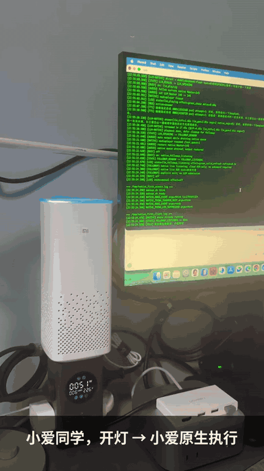
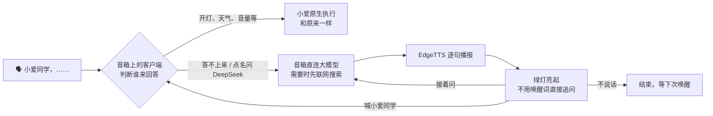

# 小米 AI 音箱 LLM 助手

[](https://github.com/open-speaker-llm/xiaomi_ai_llm/stargazers)
[](LICENSE)
[](https://github.com/open-speaker-llm/xiaomi_ai_llm/commits)
[](docs/reference/hardware.md)
[](https://www.bilibili.com/video/BV1bu4u6GEEL/)
[](https://www.youtube.com/watch?v=1R8bhbN42KE)

[English](README_en.md) | 简体中文

> **让 老款小米 AI 音箱直连 DeepSeek 等大模型：开灯、天气照旧交给小爱，答不上来的交给大模型，说完还能免唤醒接着追问。**



“搜一下最近三天的 AI 新闻，说明日期和来源。”音箱用 DeepSeek 联网查询，开始播报。播到一半，再喊“小爱同学，开灯”，灯亮了，新闻还在播。两段对话都录自同一台 **MDZ-25-DA / S12A**。

[](https://www.bilibili.com/video/BV1bu4u6GEEL/)

| 视频 | 时长 | 内容 |
|---|---|---|
| [B 站 · 实机演示](https://www.bilibili.com/video/BV1bu4u6GEEL/) | 3 分 06 秒 | 小爱搜新闻，边播边控灯 |
| [B 站 · 六月原理篇](https://www.bilibili.com/video/BV1Vzja69ELB/) | 5 分 21 秒 | 老音箱如何保留原生能力、直连大模型 |
| [B 站 · 原理速览](https://www.bilibili.com/video/BV1ShjG6tEVz/) | 1 分 35 秒 | 原理篇的短版 |
| [YouTube · Demo](https://www.youtube.com/watch?v=1R8bhbN42KE) | 1 分 34 秒 | 面向海外观众 |

> ℹ️ 主分支已支持 DeepSeek **联网搜索**。音箱直连 DeepSeek（`LLM_PIPELINE=native`、`BACKEND=deepseek`）时默认 `LLM_WEB_SEARCH=auto`：先判断问题是否需要实时信息（新闻、价格、营业状态、指定网页等）；需要时调用 DeepSeek 官方 Search/Fetch 接口，回答时说明来源。每轮会多一次判断请求，首声可能略慢；可设 `LLM_WEB_SEARCH=off` 关闭。详见 [联网搜索参考](docs/reference/native-web-search.md)。

### 哪些在音箱上，哪些在云端

| 环节 | 在哪里运行 |
|---|---|
| 唤醒、收音、路由客户端、音频播放 | **音箱本机** |
| 语音识别、家电控制、小爱原生回答 | 小米云（和原来一样） |
| 大模型（DeepSeek / GLM / Kimi / MiniMax / 任意 OpenAI 兼容接口） | **你配置的云 API**，由音箱直接调用 |
| 语音合成 EdgeTTS | 微软 Edge 在线 TTS 服务，由音箱直接调用；失败时退回小爱原生 TTS |

不需要中转服务器，也不需要电脑常驻（开发电脑只用来部署和维护）；也不需要额外的小米账号轮询程序。**但它不是离线方案**：模型不在音箱上运行，断网后只剩小爱的原生能力。

### 适用范围、难度与工具

| 项 | 说明 |
|---|---|
| 已实测型号 | **小米 AI 音箱 MDZ-25-DA**（系统代号 S12A，Amlogic A113X）。只实测过这一款 |
| 其他型号 | 未测试。外观相似不代表固件和接口相同，命令不能照搬 |
| 难度 | ★★★★☆：需要拆机、接串口、建立 SSH，可能会改写系统分区；操作失误可能变砖 |
| 是否焊接 | 不用焊接：主板上有现成的 JST 串口插座 |
| 硬件工具 | USB-TTL 模块（如 CH340）、SH1.0 转 2.54mm 杜邦 3P 线、十字螺丝刀 |
| 软件 | 开发电脑和 SSH 客户端；所选大模型的 API Key；端侧 TTS 要从源码构建的话，还需要 Rust、Zig、cargo-zigbuild |
| 费用 | 大模型 API 按各平台计费；EdgeTTS 免费 |
| 当前边界 | 还不能在 LLM 播报中途用语音打断；全天稳定性仍在验证。详见[当前状态](docs/status.md) |

从这里开始：[设备与准备](docs/reference/hardware.md) → [从零接入（串口与 SSH）](docs/getting-started/bringup.md) → [跑通第一轮对话](docs/getting-started/quickstart.md)。

### 从 mi-gpt / open-xiaoai 迁移过来？

[mi-gpt](https://github.com/idootop/mi-gpt) 和 [open-xiaoai](https://github.com/idootop/open-xiaoai) 都是本项目参考和致谢的先行项目，两者的仓库目前都已归档、停止维护。迁移前请先确认三点：

| 你原来用的是 | 和本项目的主要区别 | 迁移建议 |
|---|---|---|
| **mi-gpt**（通过小米账号接口，由电脑或 NAS 运行程序） | 本项目不走账号轮询，客户端直接跑在音箱上，不需要常驻电脑；代价是必须拆机接串口，而且只支持 MDZ-25-DA | 如果你的音箱不是 MDZ-25-DA，或者不想拆机，可以先看仍在维护的 [xiaogpt](https://github.com/yihong0618/xiaogpt)（同样走账号路线） |
| **open-xiaoai**（刷机接管音频，支持 LX06 / OH2P） | 本项目保留小爱原生识别和家电控制，只把开放问题转给大模型；**目前不支持 LX06 / OH2P** | 只有手上是 MDZ-25-DA 才适用；本项目的 `/data/init.sh` 自启动思路就来自 open-xiaoai |
| 两者共同点 | 本项目同样支持 OpenAI 兼容接口，原来的 API Key 可以直接写进 `/data/native_first.env` | 配置项对照见[配置参考](docs/reference/configuration.md) |

想了解三种接入路线的取舍，见[本项目的取舍](docs/concepts/comparison.md)。

## 用起来是什么样

```text
小爱同学，开灯                         → 小米原生执行
小爱同学，今天天气怎么样               → 小米原生回答
小爱同学，问问 DeepSeek，介绍一下西湖   → 大模型回答并播报
回答结束、绿灯续听时：那什么时候去呢？ → 沿用同一上下文继续聊
保持安静                               → 结束追问，回到待机
```

连续追问需要安装并启用对应组件。boot1 还可以增加首轮停顿续说：说到一半停约 1.5 秒，再轻声补充，音箱会继续收听；它按语音活动判停，不判断句意是否完整。

新版客户端还提供可选的[追问结束语](docs/reference/configuration.md#用结束语退出追问)：显式启用后，在续听窗口说“结束对话”即可退出。默认关闭；这项源码增强的实机验收仍待执行，具体步骤见[逐轮测试说明](docs/testing/README.md)。

## 工作原理

项目采用 **native-first（原生优先）**：复用小米的唤醒、识别和设备控制，音箱上的客户端按规则选择原生处理或转入 LLM。LLM 回答通过语音合成播放，播放完成后再进入追问窗口。



运行位置和网络依赖见上方「哪些在音箱上，哪些在云端」；可选服务端用于 TTS、联调或回退。

想继续了解分支如何判断、首轮和追问有什么区别，读[一次对话的完整过程](docs/concepts/native-first.md)。更细的技术流程（boot1 本地 VAD 等）也在这篇里。

<a id="硬件与风险声明"></a>
<a id="首轮停顿续说"></a>
<a id="当前边界"></a>

## 开始之前，先确认适用范围

目前实测设备是 **MDZ-25-DA / S12A**。安装需要拆机接串口、建立 SSH，并可能修改系统分区；已有主板插座可免焊接，但写入错误仍可能导致无法启动。先阅读[设备与准备](docs/reference/hardware.md)，确认备份和恢复条件，再进入安装步骤。

核心问答、boot1 上下文追问、首轮本地判停已有实机记录，整机重启和断电冷启动恢复也已核验。全天稳定性、更多噪声与距离条件仍待验证；尚未实现停止 LLM 的播放中语音打断。完整的双系统能力、验收证据和剩余边界统一维护在[当前状态](docs/status.md)。

## 从哪里开始读

| 你现在的位置 | 下一步 |
|---|---|
| 想先理解整个项目 | [文档导读](docs/README.md)：按问题逐层展开 |
| 手里有音箱，还没有 SSH | [从零接入](docs/getting-started/bringup.md)：先取得可靠的维护入口 |
| SSH 已可用，准备第一次部署 | [跑通第一轮对话](docs/getting-started/quickstart.md) |
| 首轮已可用，想增加追问与停顿续说 | [逐步完善对话](docs/getting-started/conversation.md) |
| 已部署，想维护或排障 | [日常操作](docs/runbooks/operations.md) / [排障](docs/runbooks/troubleshooting.md) |
| 想先做一次不会重启服务的检查 | [只读诊断](docs/reference/diagnostics.md)：配置、组件、进程与包一致性 |
| 只需要电脑提供语音合成 | [TTS 专用服务](docs/reference/server.md)：轻量安装，不加载 Whisper 或 LLM SDK |
| 更新源码后，想知道具体怎么测 | [逐轮实际测试说明](docs/testing/README.md) |
| 想了解探索过程 | [从串口到原生优先的故事](docs/history/journey.md) |

<a id="快速启动已完成部署时"></a>
<a id="服务端能力"></a>
<a id="与同类项目对比"></a>
<a id="测试"></a>

## 仓库结构

| 目录或文件 | 负责什么 |
|---|---|
| `device/` | 音箱主客户端、原生 ASR、判停、TTS 和播放适配 |
| `server/` | 可选 FastAPI 服务，入口和接口见[服务端参考](docs/reference/server.md) |
| `tools/speaker-maintenance/` | 固件补丁、组件安装和维护检查 |
| `docs/` | 阅读路径、原理、操作、参考与历史证据 |
| `tests/`、`TESTING.md` | 自动化回归与[实机验收方法](TESTING.md) |
| `device/native_first.env.example`、`config.yaml` | 设备和服务端的[配置入口](docs/reference/configuration.md) |

选择接入路线时，可继续阅读[本项目的取舍](docs/concepts/comparison.md)。

## 开源与法律免责声明

本项目是个人自有设备的本地研究和学习项目，**不隶属于、关联于或代表小米/小爱官方**。仓库中的“小米”“小爱同学”等名称仅用于说明兼容设备和技术背景。

请在使用或二次分发前理解以下边界：

- 仅在你拥有或已获授权的设备上使用本项目。不要用于未经授权的设备访问、批量控制、绕过他人设备安全限制或任何商业化远程控制服务。
- 本仓库不应包含、分发或托管任何小米固件镜像、系统分区 dump、私有二进制、模型文件、证书、密钥、账号 token、设备序列号或其他非公开资产。
- 本项目可能改变设备启动流程、启用 SSH、修改系统分区或调用本地原生服务；这些操作可能导致设备不可用、数据丢失、保修失效或违反相关服务条款，风险由使用者自行承担。
- 语音、文本、设备控制请求可能被发送到你自行配置的第三方 LLM/TTS/ASR 服务。请在使用前理解对应服务的数据处理和隐私政策，避免上传敏感语音、家庭信息、儿童信息或他人个人信息。
- 请勿将本项目用于攻击、扫描、入侵、破坏、干扰他人设备或服务；如发现安全问题，建议遵循负责任披露原则。

如果你计划公开分发修改版，请只发布自己编写的代码、配置模板和研究说明；不要把从设备中提取的小米原厂文件或个人隐私数据一并发布。

## 许可证

本仓库**自有代码**以 [MIT 许可证](LICENSE) 开源——可自由使用、修改、商用、再分发，只需保留版权与许可声明。

边界说明：MIT 仅覆盖本仓库自己编写的代码；引用的第三方项目、Rust/Python 依赖各自适用其原有许可证；上文免责声明中关于「不分发小米原厂文件/隐私数据、不用于未授权设备」的约定仍然有效。

## 相关项目

本项目在探索过程中参考了这些开源工作，特此致谢：

- [open-xiaoai](https://github.com/idootop/open-xiaoai) —— 小爱音箱接入大模型的先行项目，自启动 `/data/init.sh` 方案来源
- [duhow/xiaoai-patch](https://github.com/duhow/xiaoai-patch) —— squashfs 解包/注入/写回路线参考
- [open-lx01](https://github.com/jialeicui/open-lx01) —— rootfs 只读、`/data` 可写的结论印证
- [xiaoai-crack](https://github.com/birdsofsummer/xiaoai-crack) —— ubus 接口调用参考
