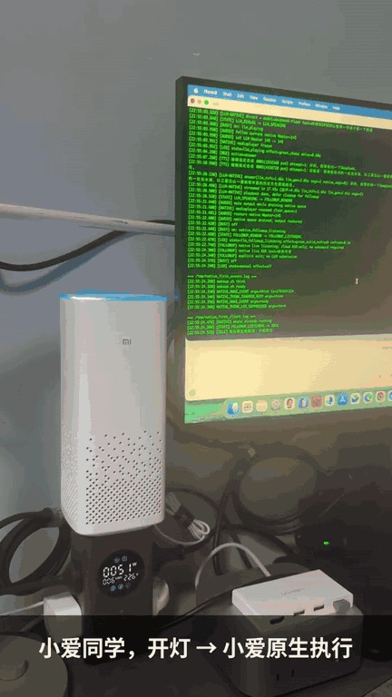
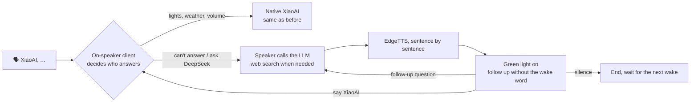

# Xiaomi AI Speaker LLM Assistant

[](https://github.com/open-speaker-llm/xiaomi_ai_llm/stargazers)
[](LICENSE)
[](https://github.com/open-speaker-llm/xiaomi_ai_llm/commits)
[](docs/reference/hardware.md)
[](https://www.youtube.com/watch?v=1R8bhbN42KE)
[](https://www.bilibili.com/video/BV1bu4u6GEEL/)

English | [简体中文](README.md)

> **Make an old Xiaomi AI speaker talk to DeepSeek (or any OpenAI-compatible LLM). Lights, weather and volume stay with native XiaoAI; questions it can't answer go to the LLM — and you can keep asking follow-ups without the wake word.**



[](https://www.bilibili.com/video/BV1bu4u6GEEL/)

| Video | Length | What you'll see |
|---|---|---|
| [YouTube · Demo](https://www.youtube.com/watch?v=1R8bhbN42KE) | 1:34 | Native XiaoAI vs. LLM on the same speaker |
| [Bilibili · Live demo](https://www.bilibili.com/video/BV1bu4u6GEEL/) (Chinese) | 3:06 | LLM reads the news; "turn on the light" mid-playback still works |
| [Bilibili · How it works](https://www.bilibili.com/video/BV1Vzja69ELB/) (Chinese) | 5:21 | Architecture walkthrough |
| [Bilibili · Short overview](https://www.bilibili.com/video/BV1ShjG6tEVz/) (Chinese) | 1:35 | Shorter cut of the architecture walkthrough |

> ℹ️ **Web search is supported on `main`.** With the speaker calling DeepSeek directly (`LLM_PIPELINE=native`, `BACKEND=deepseek`), `LLM_WEB_SEARCH=auto` is the default. The speaker first decides whether a question needs live information (news, prices, opening hours, a given web page). If it does, it calls DeepSeek's official Search/Fetch API and names its sources in the answer. This adds a routing request to each LLM turn, so the first audio may come a little later. Set `LLM_WEB_SEARCH=off` to disable it. See [docs/reference/native-web-search.md](docs/reference/native-web-search.md).

## What it's like

```text
"XiaoAI, turn on the light"                  → handled natively by Xiaomi
"XiaoAI, what's the weather today?"          → answered natively by Xiaomi
"XiaoAI, ask DeepSeek, tell me about West Lake" → LLM answers, spoken via TTS
(green light, still listening) "When should I go?" → same context, keeps chatting
"Be quiet" / silence                          → ends the follow-up, back to idle
```

The speaker understands Chinese voice commands (Xiaomi's ASR is Chinese). The trigger phrase for routing to the LLM is configurable via `DIRECT_LLM_QUERY_PATTERNS`.

## How it works — native-first

The project reuses Xiaomi's wake word, speech recognition and device control. A client running **on the speaker** reads each recognition result and decides: keep it native, or send it to the LLM. LLM answers are split into sentences, synthesized and played as they stream in; then the speaker opens a short follow-up window.



The detailed technical flow (boot1 VAD and the two system images) is in [一次对话的完整过程](docs/concepts/native-first.md) (Chinese).

### What runs where

| Part | Runs on |
|---|---|
| Wake word, mic capture, routing client, audio playback | **The speaker** |
| Speech recognition, smart-home control, native XiaoAI answers | Xiaomi cloud (unchanged) |
| LLM (DeepSeek / GLM / Kimi / MiniMax / any OpenAI-compatible API) | **Your configured cloud API**, called directly by the speaker |
| TTS (EdgeTTS) | Microsoft Edge online TTS, called directly by the speaker; falls back to native XiaoAI TTS |

No relay server and no always-on PC (your computer is only for building and deploying), and no extra Xiaomi-account polling bridge. **It is not offline**: models do not run on the speaker, and without internet only native XiaoAI features remain.

## Supported models

Set `BACKEND` in `/data/native_first.env`, or override `LLM_API_BASE` / `LLM_MODEL` / `LLM_API_KEY` for any OpenAI-compatible endpoint.

| `BACKEND` | Default model |
|---|---|
| `deepseek` (default) | `deepseek-flash` |
| `glm` | `glm-5.3-flash` |
| `kimi` | `kimi-k2.6` |
| `minimax` | `MiniMax-M2.7` |
| anything else | custom — set `LLM_API_BASE`, `LLM_MODEL`, `LLM_API_KEY` |

The client streams `/chat/completions` over SSE and speaks only the `content` field (reasoning output is not read aloud). Local models (e.g. Ollama) have not been tested.

## Is this for you?

| | |
|---|---|
| Tested hardware | **Xiaomi AI Speaker MDZ-25-DA** (system codename S12A, Amlogic A113X). Only this model has been tested. |
| Other models | Untested. Similar-looking speakers may have different firmware; commands are not portable. |
| Difficulty | ★★★★☆ — open the case, connect UART, set up SSH, possibly modify system partitions. Mistakes can brick the device. |
| Soldering | **None** — the board has an existing JST UART connector (115200 8N1). |
| Hardware | USB-TTL adapter (e.g. CH340), SH1.0-to-2.54 mm Dupont 3-pin cable, Phillips screwdriver |
| Software | A computer with SSH; an API key for your LLM; Rust, Zig and cargo-zigbuild only if you build the on-device TTS yourself |
| Known limits | No voice barge-in during LLM playback yet; all-day stability still being validated. See [status](docs/status.md). |

## Getting started

Docs are currently in Chinese; the commands and config files are universal.

1. **Check your device** — [Hardware & preparation](docs/reference/hardware.md)
2. **UART → SSH** — [Bring-up from zero](docs/getting-started/bringup.md)
3. **First conversation** — [Quickstart](docs/getting-started/quickstart.md). In short:

```sh
# on your computer, from the repo root
scp -O device/native_first_client.sh device/native_first.env.example \
    device/vad_record.sh device/data_init_native_first.sh xiaomi:/data/

# on the speaker
[ -f /data/native_first.env ] || cp /data/native_first.env.example /data/native_first.env
chmod +x /data/native_first_client.sh /data/vad_record.sh /data/data_init_native_first.sh
vi /data/native_first.env   # BACKEND=deepseek, DEEPSEEK_API_KEY=sk-..., TTS_FALLBACK_NATIVE=1
```

Then choose a TTS route and start the client as described in the quickstart.

4. **Follow-ups & pause-tolerant first turn** — [Improve the conversation](docs/getting-started/conversation.md)
5. **Operate & troubleshoot** — [Operations](docs/runbooks/operations.md) · [Troubleshooting](docs/runbooks/troubleshooting.md) · [Read-only diagnostics](docs/reference/diagnostics.md)

## Coming from mi-gpt or open-xiaoai?

Both [mi-gpt](https://github.com/idootop/mi-gpt) and [open-xiaoai](https://github.com/idootop/open-xiaoai) — pioneering projects this work learned from — are now archived.

| You used | Key difference | Suggestion |
|---|---|---|
| **mi-gpt** (Xiaomi account API, program runs on a PC/NAS) | Here the client runs on the speaker itself — no always-on PC — but you must open the case and it only supports MDZ-25-DA | If you have another model or don't want to open it, look at the maintained [xiaogpt](https://github.com/yihong0618/xiaogpt) |
| **open-xiaoai** (custom firmware takes over audio; LX06 / OH2P) | Here native XiaoAI recognition and device control are kept; only open questions go to the LLM. **LX06 / OH2P are not supported** | Applies only if you own an MDZ-25-DA |
| Both | OpenAI-compatible APIs work here too; reuse your existing key in `/data/native_first.env` | See [configuration](docs/reference/configuration.md) |

## Repository layout

| Path | Purpose |
|---|---|
| `device/` | On-speaker client, native ASR, endpointing, TTS and playback adapters |
| `server/` | Optional FastAPI service (TTS, debugging, fallback) |
| `tools/speaker-maintenance/` | Firmware patching, component install, maintenance checks |
| `docs/` | Guides, concepts, runbooks, reference, history |
| `tests/`, `TESTING.md` | Automated regression tests and on-device acceptance |

## Disclaimer

This is a personal research project for devices you own. It is **not affiliated with, endorsed by, or representing Xiaomi / XiaoAI**. Names are used only to describe compatible hardware.

- Use only on devices you own or are authorized to modify.
- This repo does not and must not contain Xiaomi firmware images, partition dumps, proprietary binaries, keys, tokens or serial numbers.
- Modifying boot flow, enabling SSH or writing system partitions may brick the device, void the warranty or breach terms of service. You take the risk.
- Voice, text and control requests may be sent to the third-party LLM/TTS/ASR services you configure. Check their privacy policies; avoid sensitive or children's data.

## License

Code written for this repository is released under the [MIT License](LICENSE). Third-party projects and dependencies keep their own licenses.

## Acknowledgements

- [open-xiaoai](https://github.com/idootop/open-xiaoai) — pioneer of LLMs on XiaoAI speakers; source of the `/data/init.sh` autostart approach
- [duhow/xiaoai-patch](https://github.com/duhow/xiaoai-patch) — squashfs unpack/inject/write-back reference
- [open-lx01](https://github.com/jialeicui/open-lx01) — read-only rootfs, writable `/data`
- [xiaoai-crack](https://github.com/birdsofsummer/xiaoai-crack) — ubus interface reference
