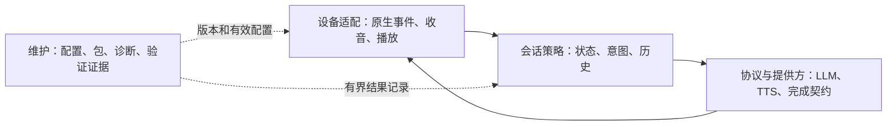

# 产品能力与架构演进路线

审查基线：`2156821`，日期：2026-10-30。范围包括设备端 native 主线、可选服务端、配置、发布维护和验证体系。前两轮的可靠性修复见[功能审查与执行方案](2026-10-30-functional-review.md)，本页组织后续能力及模块演进，交付事实以[状态页](../status.md)为准。

## 产品目标与约束

日常使用需要连续完成“听懂问题、选择正确能力、完整播报、继续或结束、异常后恢复”。增强能力应沿着这条链路建设，而不只增加模型和配置项。

- 保留音箱直连 LLM、设备端 Microsoft EdgeTTS 和原生追问主线。现有设备 TTS 不依赖 Whisper 或 LLM SDK；可选 Python 服务的依赖拆分不代表音箱换了语音方案。
- 原生唤醒与家居控制继续可用。播放期间唤醒小爱控制家电是已有历史验收行为，不把它默认改成停止 LLM。
- 区分会话缓存、可选长期记忆和维护证据。缓存不能无限增长，切换话题不等于删除磁盘数据，未选择长期记忆时不自动跨会话带入个人信息。
- 模型输出的“已执行”不能作为设备动作凭据。路由、执行结果和用户听到的反馈应分别有明确契约。
- 实际固件、组件和安装来源决定能否部署；源码回归、包体校验、ARM 执行与真人体验是不同层次的证据。

以上约束依据[原生追问](../history/2026-09-06-boot1-native-followup.md)、[并行唤醒](../history/2026-09-09-parallel-wake-reference.md)和[最终日常包](../history/first-turn-endpoint/native-daily-20260919.md)记录。历史已验收能力仍需在新包上复验。

## 本轮可独立交付的增量

| 增量 | 直接价值 | 实现范围 | 不包括 |
|---|---|---|---|
| 会话生命周期 | 明确换话题，限制多轮使用的缓存开销 | 默认关闭的精确换话题控制；确认播报后继续收听；新 session；受限且可识别的 native 历史缓存 | 长期记忆、跨用户自动续聊、远程删除服务器旧历史 |
| 统一协议模块 | 中文转义和多行文本完整；修改协议有单一来源 | 纯 JSON/SSE 源模块、确定性嵌入工具、构建漂移检查；设备仍部署自包含脚本 | 整个客户端已经模块化、额外的设备 Python/jq 依赖 |
| M05-A 候选包来源与离线预检 | 构建输出可追踪，损坏或证据不足时提前拒绝 | `release.json`、摘要绑定、受限归档检查、离线目标信息检查、临时构建成功后发布 | 现有日常包直接升级、远程激活、自动回滚放行 |
| 异常进程恢复 | 已退出但未回收的进程不再永久占用会话 | 只读进程状态判据；保留未知所有权；恢复时保留路由拒绝记录 | 任意 PID 复用问题已解决、设备 ABI 和冷启动已验收 |

会话、协议和维护分别由三个开发 Agent 实施，主控负责原生恢复、跨模块检查、全量回归和逐轮测试说明。对应[第三轮实际测试说明](../testing/2026-10-30-session-and-maintenance.md)记录具体操作与未执行的设备用例。

## 模块边界与拆分顺序

这是演进目标。当前 `native_first_client.sh` 仍承担会话编排、播放和设备适配，本轮只把无设备副作用的协议层提取为独立源码，不能据此称已完成架构重构。

| 边界 | 应当拥有的职责 | 不应承担的职责 | 落地顺序 |
|---|---|---|---|
| 设备适配 | boot0/boot1 原生事件、收音租约、播放资源、物理唤醒交接 | 自行决定是否把聊天内容变成家电动作 | 保留现有接口，先补生命周期契约，再逐段提取 |
| 会话策略 | session、轮次、历史预算、精确会话命令、输入补全、路由决定 | 解析厂商 JSON、持有合成进程、直接执行任意 shell | 本轮建立历史与换题边界；下一步提取纯意图路由 |
| 协议与提供方 | 字符编码、JSON/SSE、模型完成信号、TTS 完整句与错误结果 | 修改全局会话、控制灯效、宣称声音已被听到 | 先统一纯协议；再明确生成、合成、播放各自的结果契约 |
| 配置与维护 | 有效配置、版本来源、兼容规则、包校验、可回退发布 | 通过放宽旧包哈希来推断兼容，或凭进程存在宣称可用 | 候选预检 → 配置预览 → 整包升级演练 |

模块提取需要同时保留可部署产物和公开测试入口。纯函数直接从模块测试，嵌入客户端跑相同契约；逐步减少测试通过文本扫描提取函数、依赖隐含全局变量的做法。每次只迁移一个边界，避免在收音、取消和播放尚未有明确契约时一次性改写状态机。

## 后续执行队列

P1 表示优先保障日常闭环和维护可靠性，P2 表示在前置条件满足后增加体验能力；并非所有项目都要同时开发。

| 顺序 | 功能或工程能力 | 用户价值与执行方案 | 完成标准与依赖 |
|---|---|---|---|
| 1 / P1 | M03 有界阶段记录 | 每轮关联 session/轮次，记录模型首字、每句就绪、TTS 首音频/重试、播放提交和退出原因；数量、总字节和保留期有上限，不默认保存对话正文 | 确定性故障能区分文本等待、TTS 等待和播放等待；日志无密钥/完整服务 URL；FIFO 提交不标成实际声学首声。先用于解释历史停顿，再实施 M04 |
| 2 / P1 | M05-B 整包升级与回退 | 明确允许的来源版本、目标固件和依赖，生成升级预览；完整备份 client/SO/manager/runtime/config，分阶段校验与切换，失败回到同一完整版本 | 在独立夹具和匹配设备覆盖断传、空间不足、异常退出、重启、回退；旧包可继续服务。依赖本轮 M05-A 与 ARM/固件证据，不能直接复用首次安装器冒充升级器 |
| 3 / P1 | 配置预览与一致性 | 同一解析契约给出实际 pipeline、TTS 地址来源、覆盖项、需要的组件和何时生效；配置错误在启动前报出，输出隐藏凭证 | 客户端、自启动和 doctor 对同一输入得出一致模式；独立覆盖 `TTS_SERVER` 与 `SERVER` 不同的情形；不执行候选配置。先修确定的地址漂移，再考虑集中 schema |
| 4 / P1 | 跨平台发布检查 | 固化 Linux + macOS 回归、协议产物漂移检查、ARM32/ARM64 编译；明确跳过项，产物绑定源码版本 | 干净检出可重复执行；无云密钥也能验证；Linux 的进程、FIFO 和编译差异不能被 macOS 通过掩盖。设备执行继续单独记录 |
| 5 / P1 | M06 可选服务端历史一致性 | 为文字流、语音流和 WebSocket 分别定义正常完成、断连、模型失败和 TTS 失败；只提交符合接口契约的一轮 | 错误提示和半个回答不作为完整 assistant 历史；服务端只能证明输出完成，不能证明音箱实际听见。与 native 历史实现分开验收 |
| 6 / P2 | 追问中的原生指令 | 把聊天、会话控制、明确家控、音量和歧义输入分开；隔离路由先测试，再接入已验证原生 NLP 入口；失败反馈来自执行结果 | 覆盖否定、引述、多动作、原生失败和开放问答；真实灯具/音量动作另做真人验收。依赖会话边界和原生执行入口，模型不得自由输出设备命令 |
| 7 / P2 | 明确停止当前播报 | 为生成、合成、播放和预热收音统一取消令牌，清理本轮资源，拒绝迟到结果；入口与原生并行唤醒分开 | 四个阶段取消后下一轮可用，不重播残句、不误关新会话；默认家控唤醒仍不打断 LLM。需要完整资源所有权与实机听觉证据 |
| 8 / P2 | 适合语音的回答模式 | 提供简洁/标准/详细偏好，在模型提示层控制口语结构和目标长度，允许用户追问展开；不硬截断答案冒充简洁 | 默认行为稳定，数字/列表可听懂；“详细讲讲”在同一 session 生效；长回答的完成和错误契约不变。先用固定问集比较体验 |
| 9 / P2 | 可选只读工具能力 | 从一个明确场景开始，例如读取用户配置的状态或资料；工具参数结构化、能力白名单、超时、来源和失败结果明确 | 先完成无真实副作用的端到端用例；外部文本不能变成系统命令；工具失败不能伪造成功。真实控制工具要另设明确授权与执行契约 |
| 10 / P2 | 可导出长期记忆 | 用户显式保存偏好/事实，区分临时上下文；支持查看、更正、删除和导出，回答时只取相关条目 | 共享音箱不自动归属身份，不偷偷延长所有聊天保存期；删除和导出实际可验证。依赖存储预算、身份/会话设计及可解释的检索策略 |

上述新能力均是执行队列，未纳入本轮已实现清单。长期记忆、工具调用和家控会显著扩大行为范围，应各自独立设计与验收，不能只增加一个 LLM 提示词便宣称具备对应能力。

## 验证与交付门槛

1. 用当前代码复现现象或固定新功能契约，再修改。历史聊天与记录是线索，旧分支的通过数不能当作当前结果。
2. 开发 Agent 在限定文件/函数内实施；另一个 Agent 或主控独立检查边界和失败行为，跨模块依赖由主控整合。
3. 运行对应专项与完整主机回归；原生修改增加目标架构编译，涉及 ABI、收音、播放或家控时另列设备验收。
4. 每轮更新功能文档、状态页和可照做的人工步骤，标出配置、适用版本、预期、失败记录和恢复方式。
5. 代码与文档一并提交发布；部署必须满足目标包的兼容与回退条件。未执行的设备测试保持未执行。

历史停顿的根因仍需新增阶段证据，不能凭观察不到复现就宣称修复。当前第一安装器也仍只有固定旧基线支持；候选包格式合法并不自动获得升级资格。
